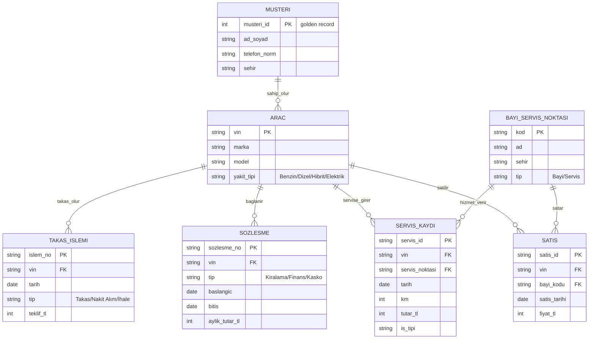

# Domain Model – Elektrifikasyon Zekâ Platformu

> Tüm veri sentetiktir. Kaynak sistem yapıları **varsayımdır**; gerçek Borusan sistemlerini yansıtmaz.

## 1. Neden bu model?
Grupta bir araç, sırayla farklı şirketlerin sistemlerinden geçer. Her sistem müşteriyi **kendi kaydıyla** tutar.
Model iki sabit nokta etrafında kurulur: **Müşteri** ve **Araç (VIN)**. Diğer her şey bu ikisine bağlanan olaydır.
Yeni bir marka ya da şirket eklemek = yeni bir kaynak tablo + Müşteri/Araç'a bağlama. Mimari değişmez.

## 2. Hedef model (Silver/Gold'un varacağı yer)

## 3. Kaynak sistemler (Bronze girdisi) – bilerek dağınık

| Kaynak (varsayım) | Dosya | Satır | Müşteri alanı | Araç anahtarı |
|---|---|---|---|---|
| DMS satış (Borusan Oto) | `dms_satis.csv` | 2.732 | `musteri_adi`, `telefon` | `sasi_no` |
| Premium (kira/finans/kasko) | `premium_sozlesme.csv` | 1.445 | `musteri_unvani`, `iletisim_tel` | `vin` |
| Servis sistemi | `servis_kayit.csv` | 8.690 | `sahip_adi` | `sasi` |
| Borusan Next (takas/ikinci el) | `next_islem.csv` | 362 | `musteri` | `vin_no` |
| Bayi/servis noktaları | `bayi_servis_noktalari.csv` | 18 | – | – |

**Kilit nokta:** Aynı alan 4 sistemde 4 farklı adla geçiyor (`sasi_no`, `vin`, `sasi`, `vin_no`) ve ortak bir müşteri ID'si yok.
Müşteri, ancak VIN + isim + telefon üzerinden eşleştirilebilir. Silver'ın işi budur.

## 4. Bilerek eklenen bozukluklar (Silver bunları çözecek)

| Bozukluk | Örnek | Silver kuralı |
|---|---|---|
| İsim yazımı | `ozan şahin`, `OZAN ŞAHİN`, `Ozan Sahin`, `  Ozan  Şahin `, `Şahin Ozan` | Normalize et (trim, büyük/küçük, Türkçe karakter, ad-soyad sırası) |
| Telefon formatı | `05305614226`, `+905305614226`, `0 (530) 561 42 26`, boş | Tek formata (10 hane) çevir, boşları işaretle |
| Tarih formatı | `2024-08-12`, `12.08.2024`, `12/08/2024` | Tek formata çevir |
| VIN hataları | boş, 16 karakter, küçük harf | Büyüt, 17 hane doğrula, hatalıyı **reddedilen** tablosuna yaz |
| Marka yazımı | `BMW `, `range rover`, `DISCOVERY` | Standart marka listesine eşle |
| Mükerrer satır | ~%1,5 satış satırı iki kez | `sale_id` ile tekilleştir |
| Mantık hatası | Sözleşme bitişi başlangıçtan önce (~%2) | Kural ihlali olarak işaretle, reddet |

Silver'ın doğruluğunu ölçmek için gizli bir `ground_truth/vin_to_customer.csv` üretildi
(her VIN'in gerçek sahibi). Müşteri eşleştirmesinin **yüzde kaç doğru** olduğunu rakamla gösterebileceğiz.

## 5. Veride gömülü iş hikayesi (Gold'da ortaya çıkacak)
- MINI satışlarının yaklaşık %90'ı elektrikli (gerçek dünya trendine paralel).
- EV'lerin ortalama servis maliyeti içten yanmalıdan düşük (**varsayım**).
- EV'lerin ikinci el teklifi daha düşük oranda (**varsayım**: daha hızlı değer kaybı).
- Sözleşmesi yakında bitecek ve içten yanmalı aracı olan müşteriler = **EV geçiş fırsatı**.

## 6. Mülakatta anlatılacak 3 cümle
1. "Modeli iki sabit nokta etrafında kurdum: Müşteri ve VIN. Her yeni kaynak bunlara bağlanır."
2. "Kaynak sistemleri bilerek kirli ürettim, çünkü veri yönetişiminin değeri temizlenmiş veride değil, **temizliğin ölçülebilir ve izlenebilir olmasında**."
3. "Müşteri eşleştirmesinin doğruluğunu gizli bir gerçek veriyle ölçtüm; rakam Silver katmanının kalite kanıtı."
