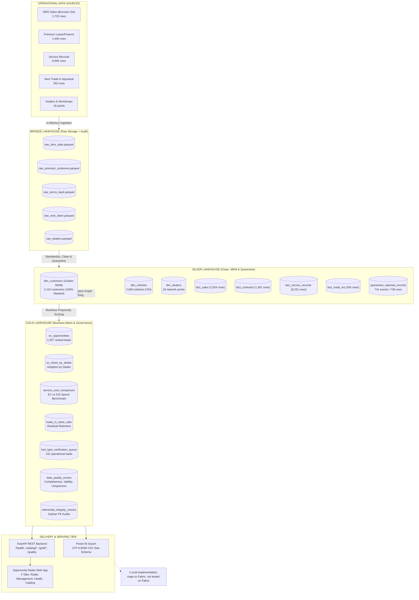

# Electrification Intelligence Platform (Borusan Otomotiv Group)

[](https://www.python.org/)
[](https://learn.microsoft.com/azure/databricks/lakehouse/medallion)
[](docs/fabric_mapping.md)
[](tests/)
[](#)
[](#)

> **Executive Case Study:** An enterprise-grade, offline-first Medallion Lakehouse and Opportunity Radar platform designed for an automotive distributor group in Turkey representing premium automotive brands (**BMW, MINI, BMW Motorrad, Range Rover, Defender, Discovery, Jaguar**) and value-chain subsidiaries (**Borusan Oto, Borusan Otomotiv Premium, Borusan Next**).
>
> *Note: All operational data is synthetic and engineered to simulate real-world data quality, duplicate identities, and master data integration challenges without exposing actual customer records.*

---

## 1. Problem Statement

Automotive conglomerates frequently operate decentralized business units where each daughter company maintains separate operational systems:
- **Borusan Oto (Dealership & Service):** DMS sales transactions (`dms_satis.csv`) and workshop service history (`servis_kayit.csv`).
- **Borusan Otomotiv Premium (Financial Services):** Long-term fleet leasing, financing, and insurance contracts (`premium_sozlesme.csv`).
- **Borusan Next (Remarketing):** Certified pre-owned vehicle appraisal, trade-in, and valuation transactions (`next_islem.csv`).

### Operational Friction & Data Quality Challenges
1. **No Master Customer Identifier:** Each source system assigns internal identifiers with no cross-entity master customer key.
2. **Dirty & Fragmented Data:** Customer records suffer from name-surname inversions (`Ozan Şahin` vs. `Şahin Ozan`), spelling noise, Turkish character loss (`GUSIOC`), missing phone numbers (service records have no phone column), irregular date formats (`DD.MM.YYYY`, `YYYY-MM-DD`), and illogical contracts (`bitis < baslangic`).
3. **Strategic EV Conversion Pressure:** With corporate electrification targets and growing EV adoption (e.g., MINI's ~90% EV mix), dealership advisors lack a unified, prioritized radar showing which internal combustion engine (ICE) customers are primed for an EV transition based on contract expiration dates and vehicle maintenance burdens.

---

## 2. Architecture & Lakehouse Mapping

The platform is designed following the **Medallion Architecture (Bronze $\rightarrow$ Silver $\rightarrow$ Gold)**, mapping conceptually to a **Microsoft Fabric OneLake** implementation:

> [!NOTE]
> **Prototype & Fabric Note:** This platform is an **end-to-end working prototype on synthetic data** (local implementation; maps to Fabric, not tested on Fabric). Local Parquet files, Python pipelines, and FastAPI serve as local analogs to Fabric Lakehouse Delta tables, Fabric Notebooks, and Azure API layers. See [`docs/fabric_mapping.md`](file:///c:/Users/DENIZ/Desktop/borusan/docs/fabric_mapping.md) for the complete cloud transition mapping.



---

## 3. Quickstart & How to Run

The entire platform runs offline with standard Python 3.10+ and zero database server setup.

```bash
# 1. Activate virtual environment and install dependencies
python -m venv .venv
.\.venv\Scripts\activate
pip install -r requirements.txt

# 2. Run the end-to-end lakehouse pipeline (Idempotent 5 layers)
python -m pipeline.run_all

# 3. Print verified key metrics directly from outputs
python -m pipeline.key_numbers

# 4. Launch the API & Web Application
uvicorn api.main:app --host 127.0.0.1 --port 8000
# Open http://127.0.0.1:8000/app/ in your browser

# 5. Run the full unit and data quality test suite (67 tests)
pytest -v
```

---

## 4. Project Folder Structure

```
c:\Users\DENIZ\Desktop\borusan\
├── config.py                       # Central paths, scoring weights, reference date (2026-10-09)
├── catalog_config.json             # Curated data catalog and metric governance definitions
├── requirements.txt                # Core offline dependencies (pandas, pyarrow, fastapi, uvicorn, pytest)
├── PROJECT_BRIEF.md                # Comprehensive architectural and domain specification
├── README.md                       # High-level architecture, design decisions, and roadmap
│
├── data/                           # Medallion Lakehouse Local Storage
│   ├── raw/                        # 5 Source operational CSV files
│   ├── bronze/                     # 5 Raw Parquet files with ingestion timestamps and hashes
│   ├── silver/                     # Cleansed facts, golden dimensions, and rejected_records
│   ├── gold/                       # Analytical marts, scoring queues, and DQ scorecards
│   ├── meta/                       # pipeline_runs.parquet, catalog.json, metrics.json
│   ├── export/powerbi/             # UTF-8 BOM CSV exports for Power BI Desktop
│   └── ground_truth/               # Synthetic vin_to_customer.csv benchmark
│
├── pipeline/                       # Lakehouse ETL & Data Engineering Modules
│   ├── bronze.py                   # Raw ingestion with schema discovery and row hash
│   ├── silver_clean.py             # Normalization, domain rules, and dead-letter quarantine
│   ├── silver_customers.py         # Rule-based entity resolution and golden customer clustering
│   ├── gold.py                     # Opportunity radar scoring and analytical aggregations
│   ├── catalog.py                  # Dynamic schema discovery and Purview-compatible catalog
│   ├── export_for_powerbi.py       # UTF-8 BOM CSV exporter with strict Zero-PII sanitization
│   ├── key_numbers.py              # Extract and print verified metrics directly from outputs
│   ├── logging_utils.py            # Non-negotiable execution audit logging
│   └── run_all.py                  # Master idempotent 5-layer pipeline runner
│
├── api/                            # Delivery Tier REST API
│   ├── main.py                     # FastAPI backend (health, catalog, quality, gold, silver)
│   └── utils.py                    # RFC 8259 JSON safety, NaN/NaT sanitation, PII masking
│
├── app/                            # Front-End Web Application
│   └── static/
│       ├── index.html              # Opportunity Radar SPA (4 executive tabs + side drawer)
│       ├── style.css               # Clean, responsive dark-navy / slate / white styling
│       └── app.js                  # Vanilla JS controller with inline SVG charts (zero CDN)
│
├── docs/                           # Enterprise Architecture & Review Documentation
│   ├── fabric_mapping.md           # 1:1 Microsoft Fabric Lakehouse & Azure migration guide
│   ├── powerbi_model.md            # Star-schema semantic model & 4 key DAX measures
│   ├── demo_script.md              # 7-minute presentation demo script with key numbers
│   ├── presentation_outline.md     # 10-slide executive presentation outline & ROI formula
│   └── screenshots/                # Browser-verified captures of all 4 application tabs
│
└── tests/                          # Automated Pytest Unit & Integration Tests
    ├── test_bronze.py              # Ingestion integrity and schema drifting
    ├── test_silver_clean.py        # Cleansing logic and exact row reconciliation
    ├── test_silver_customers.py    # Entity resolution accuracy and privacy masking
    ├── test_gold.py                # Propensity scoring, capping, and DQ score audits
    ├── test_catalog.py             # Schema discovery and metric glossary completeness
    ├── test_api.py                 # Endpoint contracts, JSON compliance, and PII scanning
    ├── test_key_numbers.py         # Key metrics output verification
    └── test_export_powerbi.py      # Power BI CSV UTF-8 BOM and Zero-PII validation
```

---

## 5. Key Design Decisions & Trade-Offs

| Decision | Rationale | Trade-Off & Alternative Considered |
|---|---|---|
| **1. Local Parquet Lakehouse (No RDBMS)** | Columnar Parquet matches Microsoft Fabric OneLake / Delta Lake storage format conceptually, requires zero database server administration, and enables blazingly fast analytical scans via PyArrow. | Lacks ACID transactional row locking and multi-user concurrency provided by PostgreSQL or SQL Server. |
| **2. Dead-Letter Quarantine (No Silent Drops)** | In enterprise governance, discarding invalid rows silently distorts auditability. Every rejected row is recorded in `rejected_records.parquet` with explicit rule codes (`MISSING_VIN`, `INVALID_VIN`, `DUPLICATE_KEY`, `CONTRACT_END_BEFORE_START`). Exactly 3 multi-rule rows in `dms_satis` are duplicate `sale_id` rows that also have an invalid/missing VIN (phone is not a rejection rule). | Requires maintaining a separate quarantine table and auditing foreign key referential integrity against orphan fact records. |
| **3. Conservative Entity Resolution** | Enforces the strict rule: *"Never merge customers on name alone; a name match requires a shared valid VIN or phone."* In Turkey, common names (e.g., Mehmet Demir) create catastrophic false positives if linked solely by token similarity. | Sacrifices a small percentage of recall (82.68%) to achieve 100% precision and 100% cluster purity, ensuring advisors never pitch to the wrong customer. |
| **4. Configurable Reference Date (`2026-10-09`)** | Decoupling date math from `datetime.today()` allows deterministic unit tests, backfilling, and time-travel replayability. | Requires explicitly passing `REFERENCE_DATE` through pipeline functions rather than relying on system clock. |
| **5. Strict Zero-PII Presentation Layer** | Raw names and phones are isolated strictly in internal Silver transformations. API responses, UI displays, and Power BI exports strictly expose masked tokens (`O*** Ş****`, `530***4226`). | Debugging requires correlating `customer_id` through internal Silver keys rather than directly querying customer names. |
| **6. Zero-CDN Vanilla Web Application** | 100% offline, zero build step, and zero third-party script tracking. Charts are drawn dynamically using inline SVG elements. | Requires writing custom chart layout mathematics instead of relying on heavy charting libraries like Chart.js or D3. |

---

## 6. Limitations and Honesty Notes

> [!IMPORTANT]
> This repository represents an **end-to-end working prototype on synthetic data**. To maintain engineering integrity, the following boundaries and assumptions must be highlighted:

1. **Synthetic Operational Data:** All operational records (DMS sales, leasing contracts, service work orders, trade-in valuations) were synthetically generated for this prototype.
2. **Generator Assumptions, Not Real Findings:** The EV service-cost comparison (~40% lower maintenance spend for EVs) and Borusan Next trade-in retention ratios reflect the generative rules of the synthetic data generator, not empirical business findings.
3. **Upper Bound on Opportunity Leads (Recall 82.68%):** Because of conservative record matching ("never merge on name alone"), pairwise recall against synthetic ground truth is 82.68%. This means some real customers with fragmented attributes remain split across multiple customer IDs rather than merged. Therefore, the 1,057 lead count in `ev_opportunities` represents an **upper bound** on the true unique customer count.
4. **Quarantined Records Excluded from Evaluation:** The 738 rejected rows (741 rule events) in `rejected_records.parquet` were quarantined prior to customer entity resolution and are not evaluated in the ground-truth benchmark metrics.
5. **Data Quality Definitions & Silver Validity:**
   - **Bronze Sales Validity:** 97.33% (evaluated on raw ingestion rules).
   - **Quarantine Rejection Rate:** 5.57% (738 distinct rows out of 13,247 raw rows).
   - **Referential Integrity Orphan Rates:** Service records 5.52% (454 rows), leasing contracts 5.00% (68 rows), trade-ins 6.09% (21 rows).
   - **Silver Validity:** 100.00% **by construction** (only valid rows are admitted into the Silver layer); this is an architectural invariant, **not an external quality achievement**.
6. **Local Implementation (Not Tested on Microsoft Fabric):** The code runs locally on Python, PyArrow, and FastAPI. While the architecture and naming map conceptually 1:1 to Microsoft Fabric (OneLake, Delta Lake, Fabric Notebooks, Purview, Direct Lake), it has **not been tested on live Microsoft Fabric infrastructure**.
7. **No Authentication / Access Control (RBAC):** The REST API and web application currently run without user authentication or row-level security (RLS), suitable for local evaluation only.
8. **No LLM Layer in Core Runtime:** All propensity scoring, lead ranking, and sales pitches are **100% deterministic, rule-based heuristics** written in Python and JavaScript. There is no LLM or generative AI in the core execution path, ensuring deterministic reproducibility, zero token expenses, and zero hallucination.

---

## 7. Roadmap ("What I Would Do Next")

If transitioning this end-to-end working prototype on synthetic data to enterprise cloud production:

1. **Real Source Connectors (Change Data Capture - CDC):** Deploy Microsoft Fabric Data Factory / Azure Data Factory pipelines with CDC connectors extracting incremental transaction deltas directly from DMS (Turkuaz/SAP), Salesforce CRM, and leasing core banking systems.
2. **Telematics & Public Charging Network Integration:** Ingest live IoT telemetry (vehicle state of charge, annual mileage, daily commuting patterns) and charging network APIs (Trugo, Eşarj) to score customer EV readiness based on actual driving habits.
3. **Event-Driven Push Notifications:** Implement Azure Event Grid / Webhooks that push proactive notification cards to sales advisors' Microsoft Teams or WhatsApp Business accounts the moment a high-propensity customer (80+ score) enters their 90-day contract renewal window.
4. **Enterprise Role-Based Access Control (RBAC & RLS):** Configure Azure Entra ID authentication and Power BI Row-Level Security so dealer principals and sales advisors only view records for their assigned dealership point.
5. **Conversational Semantic Layer with Whitelisted Tools:** Build an enterprise LLM agent (via Semantic Kernel / Azure OpenAI) allowing executives to ask natural-language questions in Turkish (e.g., *"Hangi bayide sözleşmesi 60 gün içinde bitecek BMW 5 Serisi sahipleri var?"*), executing strictly against whitelisted SQL views and documented API endpoints to eliminate hallucinations and SQL injection risks.
6. **Multi-Brand Extensibility:** Develop modular schema adapters enabling new automotive brands (e.g., BYD, Polestar, Porsche) to plug into the ingestion layer with zero changes to the core entity resolution and scoring engines.

