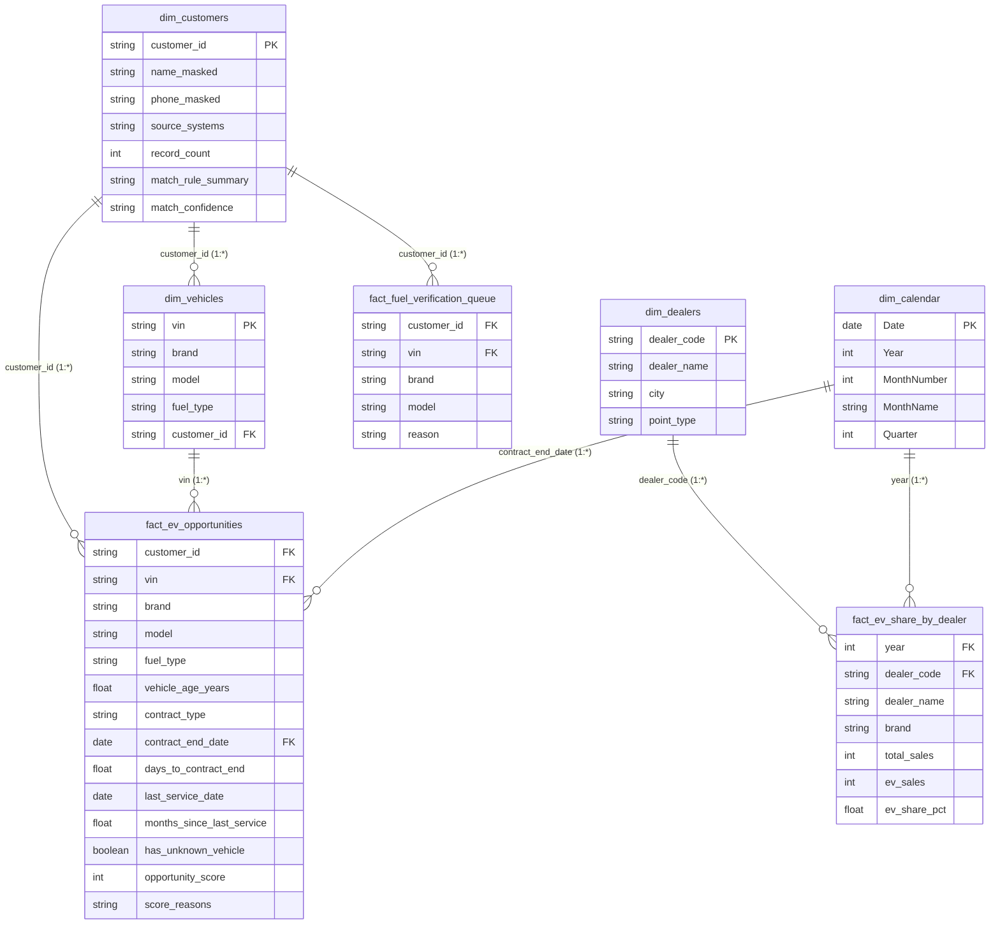

# Power BI Semantic Model & Star-Schema Specification

> **Project:** Electrification Intelligence Platform (Borusan Otomotiv Group)  
> **Source Directory:** `data/export/powerbi/*.csv` (Encoded in UTF-8 with BOM `utf-8-sig`)  
> **Governance Standard:** Zero-PII presentation layer (100% masked customer identifiers)

---

## 1. Dimensional Architecture Overview

The Power BI reporting model is structured as a **Star-Schema** semantic model. It separates operational master data entities into **Conformed Dimensions** (`dim_customers`, `dim_vehicles`, `dim_dealers`) and transactional analytical metrics into **Fact / Aggregation Tables** (`fact_ev_opportunities`, `fact_ev_share_by_dealer`, `fact_service_cost`, `fact_trade_in_retention`, `fact_data_quality`).

### Zero-PII Compliance & Windows Compatibility
- **UTF-8 with BOM (`utf-8-sig`):** Every exported CSV file begins with byte mark `\xef\xbb\xbf`. This ensures that Power BI Desktop on Windows automatically parses Turkish character sets (`İ`, `ı`, `ş`, `ğ`, `ç`, `ö`, `ü`) without requiring manual code page overrides in Power Query.
- **Strict Masking:** Unmasked names (`display_name`, `customer_name_clean`) and raw 10-digit mobile numbers (`phone_norm`, `phone_raw`) are stripped before export. Only masked tokens (`name_masked`: `"O*** Ş****"`, `phone_masked`: `"530***4226"`) are exposed.

---

## 2. Star-Schema Entity-Relationship Model



---

## 3. Table Relationship Dictionary

| From Table (Many Side) | Foreign Key | To Table (One Side) | Primary Key | Cardinality | Cross Filter Direction | Security / RLS Note |
|---|---|---|---|---|---|---|
| `fact_ev_opportunities` | `customer_id` | `dim_customers` | `customer_id` | Many-to-One (`*:1`) | Single | Primary link for customer profile & contact masking. |
| `fact_ev_opportunities` | `vin` | `dim_vehicles` | `vin` | Many-to-One (`*:1`) | Single | Links vehicle attributes and fuel specification. |
| `dim_vehicles` | `customer_id` | `dim_customers` | `customer_id` | Many-to-One (`*:1`) | Single | Connects vehicle ownership cluster to Golden Customer. |
| `fact_ev_share_by_dealer`| `dealer_code` | `dim_dealers` | `dealer_code` | Many-to-One (`*:1`) | Single | Enables dealer regional slicing and performance ranking. |
| `fact_ev_opportunities` | `contract_end_date` | `dim_calendar` | `Date` | Many-to-One (`*:1`) | Single | Time intelligence for contract renewal horizon analysis. |
| `fact_fuel_verification_queue` | `customer_id` | `dim_customers` | `customer_id` | Many-to-One (`*:1`) | Single | Operational queue for fuel verification tracking. |

---

## 4. Key Business DAX Measures

The semantic model includes four standardized **DAX Measures** representing executive and operational key performance indicators.

### Measure 1: EV Share %
Calculates the adoption rate of 100% battery-electric vehicles (BEV) against total vehicle deliveries, preventing division by zero.

```dax
EV Share % = 
VAR TotalSales = SUM(fact_ev_share_by_dealer[total_sales])
VAR ElectricSales = SUM(fact_ev_share_by_dealer[ev_sales])
RETURN
    DIVIDE(
        ElectricSales,
        TotalSales,
        0
    )
```
* **Format:** Percentage (`0.0%`)
* **Business Usage:** Evaluates dealership electrification quotas and brand-by-brand EV penetration (e.g., MINI's ~90% vs. BMW's ~28%).

---

### Measure 2: Avg Opportunity Score
Computes the mean Opportunity Radar propensity score across filtered internal combustion engine (ICE) owners.

```dax
Avg Opportunity Score = 
AVERAGE(fact_ev_opportunities[opportunity_score])
```
* **Format:** Decimal (`0.0`)
* **Business Usage:** Serves as the central KPI card on executive dashboards; enables ranking dealer territories by average prospect maturity.

---

### Measure 3: Opportunities Next 90 Days
Identifies and counts prime customer leads whose finance or lease contract is due to expire within the next 90 days from the platform's reference date (`2026-10-09`), or expired recently within the 180-day grace window.

```dax
Opportunities Next 90 Days = 
CALCULATE(
    DISTINCTCOUNT(fact_ev_opportunities[customer_id]),
    fact_ev_opportunities[days_to_contract_end] >= -180,
    fact_ev_opportunities[days_to_contract_end] <= 90,
    fact_ev_opportunities[contract_type] IN { "Finans", "Kiralama" }
)
```
* **Format:** Whole Number (`#,##0`)
* **Business Usage:** Fuels the operational call queue for Borusan dealership sales advisors, prioritizing customers whose vehicle financing window is currently open.

---

### Measure 4: Data Quality Score
Aggregates the composite data governance quality score across Bronze and Silver Lakehouse tables, weighting validity, completeness, and uniqueness.

```dax
Data Quality Score = 
AVERAGE(data_quality_scores[overall_dq_score])
```
* **Format:** Percentage (`0.00%`)
* **Formula Breakdown:**
  $$\text{DQ Score} = 0.40 \times \text{Validity} + 0.35 \times \text{Completeness} + 0.25 \times \text{Uniqueness}$$
* **Business Usage:** Displayed in executive IT governance dashboards to track ingestion reliability, quarantine containment, and data cleanliness over time.

---

## 5. Recommended Power BI Report Pages

1. **EV Opportunity Radar (Advisor View):**
   - Filter Slicers: Brand (`dim_vehicles[brand]`), Dealer (`dim_dealers[dealer_name]`), Score Band.
   - Matrix Table: Customer (`dim_customers[name_masked]`), Phone (`dim_customers[phone_masked]`), Model, Contract Expiry, Propensity Score, Score Reasons.
2. **Electrification Leadership (Executive View):**
   - Gauge: `[EV Share %]` vs. Annual Corporate Target (30%).
   - Bar Chart: `[EV Share %]` by `dim_dealers[dealer_name]`.
   - Scatter Plot: Average Vehicle Age vs. Average Opportunity Score by Model.
3. **Data Governance & Integrity Cockpit:**
   - Cards: `[Data Quality Score]`, Total Quarantined Records (`741`), Orphan Rate (`5.4%`).
   - Lineage Visual: Table-by-table completeness, validity, and uniqueness audit scores.
